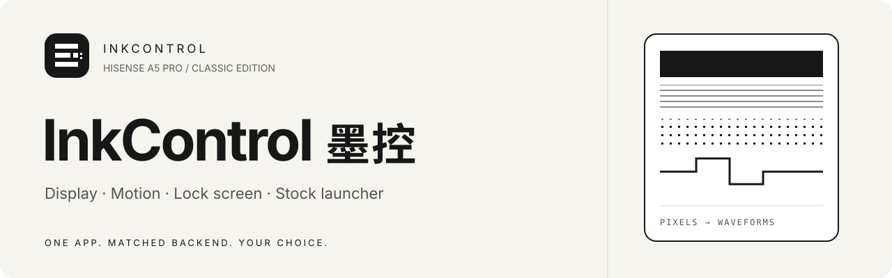
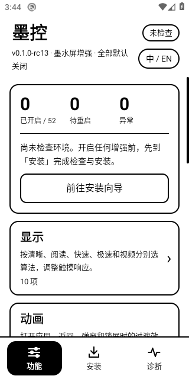
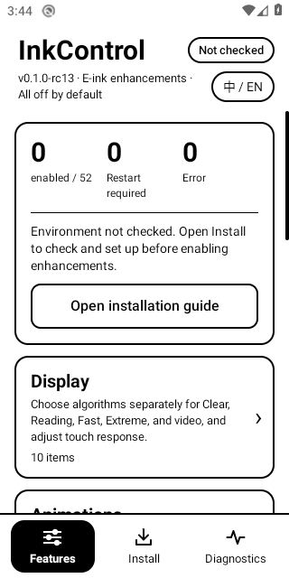

<b>中文文档（主）</b> · <a href="https://github.com/liuqianhe/InkControl/wiki"><b>知识库 / Wiki</b></a> · <a href="https://github.com/liuqianhe/InkControl/wiki/agent-handbook">Agent 从这里开始</a> · <a href="https://github.com/liuqianhe/InkControl/releases">下载安装包</a>

# 黑白之间，多一点掌控

**墨控 · InkControl**，为 **Hisense A5 Pro 经典版**打造的黑白墨水屏增强套件。用一个应用管理显示算法、过渡动画、锁屏与原厂桌面，内置与 App 匹配的 Magisk 后端。

**68 个增强全部默认关闭。** 按需开启，保留原有选择；清楚展示期望配置、运行回执和异常状态。

| 显示 | 动画 | 锁屏 | 原厂桌面 |
| --- | --- | --- | --- |
| 四种模式分别选算法，视频独立设置 | 场景效果、预览、温度停留曲线 | 天气、歌词、系统／微信通知数、四套样式、刷新策略 | 三套主题，图标、字体、组件分别选择 |
| 灰度与黑白分组，迟滞独立开关 | 复用显示链路，保留模式边界 | 逐项启停与条件恢复；像素主题（纯白背景）使用上滑箭头；自定义锁屏不叠加原厂底栏 | 保留原厂布局和应用位置 |

> **建议仅用于测试机：先把重要数据备份到电脑或独立存储。可能出现无法开机、永久数据丢失或无法恢复的设备故障，安装前请阅读[风险提示与免责声明](#风险提示与免责声明)。**

## 先找到你的入口

| 我想…… | 阅读入口 |
| --- | --- |
| 安装和开始使用 | [使用入门](https://github.com/liuqianhe/InkControl/wiki/getting-started) |
| 理解四个模式、视频和迟滞 | [显示算法](https://github.com/liuqianhe/InkControl/wiki/algorithms) |
| 排查卡顿、GPU 回退、配置未生效 | [诊断与恢复](https://github.com/liuqianhe/InkControl/wiki/operations) |
| 接手开发，理解已经做过什么 | [Agent 手册](https://github.com/liuqianhe/InkControl/wiki/agent-handbook) → [研究与结论](https://github.com/liuqianhe/InkControl/wiki/research) |
| 找源码、证据与发布流程 | [源码架构](https://github.com/liuqianhe/InkControl/wiki/architecture) · [证据索引](https://github.com/liuqianhe/InkControl/wiki/evidence) · [构建与 Release](https://github.com/liuqianhe/InkControl/wiki/build-and-release) |

## 使用方式

1. 从 [Releases](https://github.com/liuqianhe/InkControl/releases) 下载签名 APK，先看该版本说明与校验文件。`rc` 是候选预发布。
2. 安装后进入“安装”页，核对环境，从 App 导出配套后端 ZIP，交给 Magisk 安装。
3. 在 Vector／LSPosed 类框架中启用墨控，勾选系统框架、系统界面和原厂桌面作用域。
4. 完整重启，在“诊断”页检查当前状态，再逐项开启需要的功能。

适配门槛为 `HLTE203T / Android 10 / arm64 / L1732.6.01.02`，以设备检查和输入哈希为准。无 Root 也可浏览说明、切换中英文、看预览及导出安装包。[详细步骤与恢复](https://github.com/liuqianhe/InkControl/wiki/getting-started)。

> **已验证设备与系统：** 目前唯一完成实机验收的机型是**海信 A5 Pro 经典版 `HLTE203T`**，Android 10（API 29），`arm64-v8a`，系统固件 **`L1732.6.14.01.B10`**（`ro.software.version`；`ro.build.display.id` 为 `QP1A.190711.020`，`ro.build.fingerprint` 仍写作 `L1732.6.01.02`）。墨控直接依赖该固件的原厂桌面（`com.hmct.vision`）、原厂主题与显示后端内部实现，**其他机型、其他系统版本或改版 ROM 很可能不适配**，不保证可用或可恢复；换机或升级系统前请先按下方风险提示评估并做好备份。

> **签名迁移：** rc13 起使用固定的新发行签名，不能覆盖安装旧签名 App。首次迁移先备份配置并卸载旧 App，再安装新版及其配套后端；后续继续沿用该签名。

## 界面一览

<table><tr><th>简体中文</th><th>English</th></tr><tr><td></td><td></td></tr></table>

以上为 rc13 云端模拟器的实际截图，不代表真实面板观感验收。当前版本在功能首页集中显示就绪状态和“中 / EN”，分类页与功能页保持精简。应用语言默认跟随系统，可独立选择中文或英文。

## 当前进度

源码为 **0.1.0-rc16** 候选，包含分模式算法、独立迟滞、自动刷新（点击／按键／阅读界面计数与周期触发）、锁屏通知数（默认系统可清除通知，可切微信未读）、四套自定义锁屏样式（编辑排版、瑞士网格、像素【纯白背景】、液态玻璃）、双语界面、统一图标和文档知识库。全部编译和检查在云端执行，新版本通过后自动生成 Release；相同版本重跑不会覆盖已有 Release。

截至 2026-10-18 已记录的手机状态仍是 **rc10 App + rc10-gpu-fix1 后端**；[rc15 已完成云端签名、回归和四组双语界面验证](https://github.com/liuqianhe/InkControl/actions/runs/39098632837)。新候选的完整 HWC 集成、面板、功耗、温区及长期稳定需独立验收。历史首个 GPU 错误根因未确定；本固件 Google split 图标覆盖未通过，保持关闭。[验证范围](https://github.com/liuqianhe/InkControl/wiki/evidence)。

## 给开发者和 agent

先读 [AGENTS.md](AGENTS.md) 和 [Agent 手册](https://github.com/liuqianhe/InkControl/wiki/agent-handbook)。[llms.txt](llms.txt) 提供精简入口，[知识索引](docs/wiki/knowledge-index.json) 提供结构化导航和来源定位。

功能目录是唯一配置定义，界面只调用应用服务。[参与开发](CONTRIBUTING.md) · [架构](https://github.com/liuqianhe/InkControl/wiki/architecture) · [文档维护](docs/localization.md)。

仓库公开维护，中文与英文知识库见 [GitHub Wiki](https://github.com/liuqianhe/InkControl/wiki)。原创实现与标识采用 [MIT](LICENSE)；厂商二进制、第三方素材及外部框架适用各自权利，见 [NOTICE](NOTICE.md)。私钥、密码、明文固件、个人备份和原始设备日志不入 Git。

[公开前审查与 Wiki 维护](docs/publication.md)

## 风险提示与免责声明

本项目仍处于实验和候选验证阶段，**建议仅在备用机或专用测试机上使用，不建议用于承担通信、支付或重要数据存储的主力机**。云端构建、自动测试通过不代表已完成实机稳定性验收，也不保证兼容所有设备或固件。

Root、Magisk 模块、系统框架钩子及显示后端改动可能造成死机、反复重启、无法开机、数据丢失或设备损坏；**部分故障可能无法恢复，现有停用、卸载和回退机制不保证一定能救回设备或数据**。

**安装、升级或启用功能前，先备份照片、文档、聊天记录、应用数据和重要配置，并将备份复制到电脑或其他独立存储，确认能够读取。不要只把备份留在被测试的手机上。** 提前准备与当前设备、固件匹配的恢复材料及恢复方式；不清楚如何停用模块或恢复系统时，请先不要尝试。

项目按原样提供，不承诺无故障、无数据损失或可恢复。请充分了解风险，自行决定是否使用；许可中的无担保说明见 [LICENSE](LICENSE)。备份能降低数据损失风险，但不能保证设备一定可修复。
