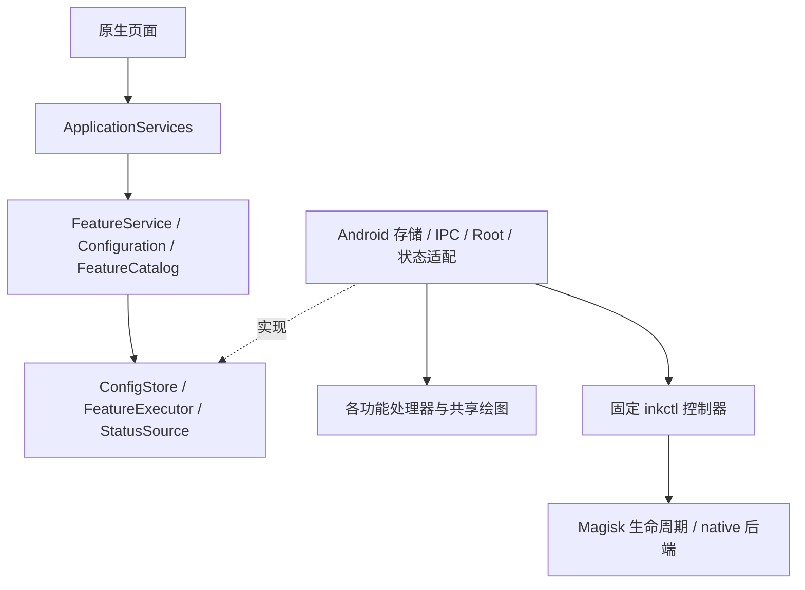

# 架构与业务规则

## 依赖方向

界面只调用应用服务，不写系统设置、不执行 Root，也不自行决定依赖。`ApplicationServices` 是 Android 组合入口，将平台实现注入纯 Java `FeatureService`。业务层不引用 Android、Xposed 或 UI。功能目录静态注册，供界面、校验、测试和构建时生成的后端白名单共同使用。

`features` 保留原有算法的实现边界。Hook 入口路由进程、注册回调；天气原始对象定位、媒体会话订阅、锁屏或桌面的绘制各有明确职责。`shared` 只抽取实际重复的天气解析、天气图标和媒体快照，不建立插件系统。没有新增 Android 常驻服务；监测复用 Magisk 的启动服务。

## 配置与状态

唯一用户配置是墨控设备加密存储中的 `files/configuration.txt`，使用 `AtomicFile` 提交。内容只允许功能目录内的开关和选项；不可执行，重复、未知和非法字段均拒绝。损坏文件保留，不能静默重置成默认成功。

用户操作依次执行参数和依赖检查、保存期望快照、应用配置、等待执行回执。Root 执行失败时保留期望值，页面明确失败并允许重试。后端 `/data/adb/inkcontrol/configuration.txt` 是 App 生成的启动输入，`applied.txt`、`boot.txt` 是回执，不作为另一套可编辑用户配置。

每份快照携带单调修订号；每个功能的期望值和实际值由同一快照结构读取。Hook 回执需要进程 PID、`/proc/PID/stat` 的开始时间、模块版本和配置修订号全部匹配。Provider 重建后丢失的内存回执不能冒充成功；需要重新通知配置或重建进程。功能处理器就绪后才能回报。

启动期功能确认本次 boot_id 和实际启动快照。后续热配置没有改变某个启动功能时，只有启动值与当前应用回执一致才可续认。GPU 还需要当前 HWC 的 helper 加载、有效遥测与零错误证据。加载确认不等于面板观感验收。进程更新、后端版本变化或旧回执不匹配时回到等待状态。

状态包括关闭、依赖未满足、待重启、已生效、异常，另有等待运行／停用确认。父级关闭保留子项的选择但停止生效。开启依赖必须由用户操作；需要 GPU 的动画在后端尚未生效时等待重启。

## 执行和恢复

动画从快照生成纯 Java `Config`，不再读取旧 `eink_motion` JSON。系统属性只是 HWC 的能力和命令通道。锁屏刷新策略、两处歌词和动画倍率独立控制。锁屏样式写入放在 SystemUI 适配器，保存原值／写入值账本，只在当前值仍由墨控拥有时恢复；有效原厂样式为 0–4，其他输入恢复为 0。

动态刷新全局键使用 before/written 账本。每应用 XML 只在 system_server 尚未启动时按字段三方合并，保留用户改动和新增项。停用、卸载时由独立 Magisk 恢复入口处理；已经完成的账本先归入 history，再开始下一次显式启用周期。

桌面保存每个视图原有字体、图标及可访问性状态，分别恢复；主题只覆盖显示，不写用户壁纸文件。视频修复停用时，仅在原因列表仍为模块写入值时恢复接管前列表，并丢弃自身计数；排队事件再次检查开关。

## 权限与切换

Provider `com.inkcontrol.state` 只有自身、系统 UID、实际 SystemUI 和原厂桌面 UID 可读；状态回报、天气、媒体及控制命令另有角色限制。没有配置写入、任意文件访问或 Root 执行的外部接口。显示服务权限增强额外校验墨控实际构建证书，证书摘要由构建生成。

Root 控制器仅接受 `status/apply/backup/migrate/manual/restore`。配置走 stdin 和白名单解析，绝不 source 用户配置。CLI 可用时只针对固定旧包名和模块 ID 操作；无 CLI 时用户手动检查，后端记录确认并要求跨完整启动。迁移前状态备份保留，旧 APK 不自动卸载。

后端启动先校验安装文件、设备、固件和原厂 HWC，再生成自己的挂载文件。`sys.inkcontrol.ready` 只有启动检查通过后开放。启动失败计数、文件完整性和回退不是增强选项。运行监测发现异常时禁止下一次 GPU 加载，要求完整重启，不在构建或归档期间重启设备。

## 明确的边界

首版每应用批量策略仅支持已实现的 515→521。未开放任意 XML 编辑、分区刷新原型或 v17。目标固件的 Vector CLI、启动挂载、配置同步与条件恢复已有实机记录，范围见 [首次实机报告](2026-10-15_墨控实机验收.md)。GPU 动画压力阶段触发过运行保护，不能据此认定后端长稳通过；模拟器也不能替代这些检查。
