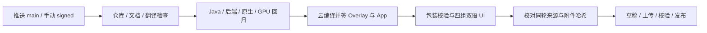

# 云构建、签名与自动 Release

[English](build-and-release.en.md) · [Wiki](README.md) · [工具链细节](../cloud-build.md)

## 发布流程

所有编译及构建验证在 GitHub 托管 Ubuntu 24.04；本地只做编辑与静态检查。PR 只跑无私有输入的检查，不拿固件与签名 secrets，也不发布。main 默认 signed；手动 unsigned 仅生成不可安装候选，不发布。工具链固定 Python 3.12、JDK21/Java8目标、Platform33、Build Tools35.0.0、NDK29.0.14206865。

## 版本与不可覆盖

当前候选 `0.1.1-rc17`；新版本通过后自动创建 `v<version>` tag 和 Release，固定到已验证的准确 commit。`-rcN` 自动标为预发布，不标记 Latest；稳定版本标记 Latest。候选状态由版本决定，云端通过不等于实机稳定版。

版本递增同步 `AndroidManifest.xml`、`tools/build.py`、`backend/lib/common.sh`、App/模块 versionCode、发布说明及知识索引。仅文档提交可以保留版本；已发布同版本直接跳过，不修改 tag、说明或附件。代码／资源行为变化必须新版本。

发布先建草稿，上传完整附件并核对服务端哈希，最后转为发布。中断后只允许恢复同 commit 的草稿；已有附件必须同哈希，不使用覆盖上传。main 的构建与发布串行，避免新推送中断发布。只有发布 job 拥有 `contents:write`。

## 发布门槛和附件

发布器只接收本次 run/attempt 的签名候选与证据，逐项核对 commit、仓库、可信公钥、App/ZIP SHA256、默认关闭和包装回执；四组双语 UI、全部回归命令、原生策略、队列与软件 GPU 输出必须通过。

| 附件 | 用途 |
| --- | --- |
| `InkControl-v<version>.apk` | 已签名 App，内置配套后端 |
| `inkcontrol_backend-v<version>.zip` | 同一份后端，供 Magisk 安装 |
| `SHA256SUMS` | 所有其他附件的 SHA256 |
| `build-manifest.json` | 准确 commit/run、输入与源码哈希 |
| `package-verification.json` | 内嵌 ZIP 一致、模块校验、默认关闭 |
| `release-verification.json` | 发布时核对的回归、UI、GPU、证书与来源 |
| `RELEASE_NOTES.md` | 中英文变更与实际验证边界 |

Actions 原始测试、UI PNG/XML 等 artifacts 保留七天；Release 附件按版本公开留存。失败的检查与 unsigned 不发布；发布器限定目标仓库身份及 Actions/main，并拒绝其他仓库。

## 签名与私有输入

新固定发行签名从 rc13 使用；公钥为 `ci/trusted-certificate.der`，私钥与随机密码只留本地和 Actions secrets。首次迁移旧签名 App 需备份并卸载，后续必须沿用新密钥。App 与 Overlay 顺序签名，不能只补签外层 APK。

两个 HWC 输入加密为 `ci/private-inputs.zip.enc`；解密在运行器临时目录，校验成员与哈希，退出清理。Release 不附原始私钥、密码、备份和明文输入。部署与正式实机交付归档仍单独执行，自动 Release 不操作手机。

实现：[workflow](../../.github/workflows/build.yml)、[发布器](../../tools/publish_release.py)。依据：[GitHub CLI Release](https://cli.github.com/manual/gh_release_create)、[Actions Secrets](https://docs.github.com/en/actions/how-tos/write-workflows/choose-what-workflows-do/use-secrets)。

每份 Release 说明都应保留醒目的测试机建议、手机之外的数据备份提醒，以及无法开机、数据丢失和故障无法恢复的风险；不得把云端通过或回退机制写成安全或可恢复的保证。
